<div align="center">

# 🎙️ MeetingNote

**회의가 끝나면 정리가 끝나 있게. 「그때 뭐라고 했더라」가 사라지게.**

녹취 파일을 올리면 받아쓰고, 본문을 **요약 · 결정사항 · 할 일** 세 갈래로 나눠 저장하는 회의록 자동 정리 풀스택 웹 앱


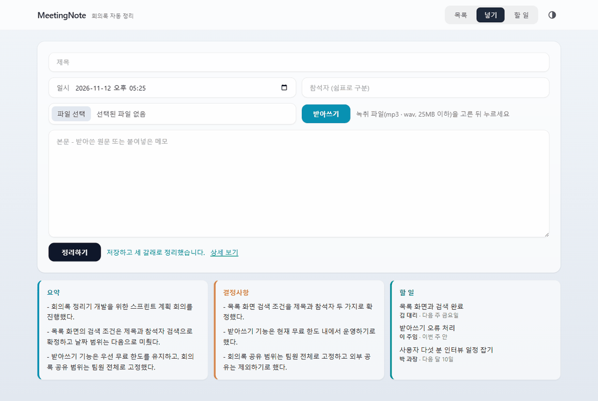

</div>

---

## 목차

- [핵심 기능](#-핵심-기능)
- [화면](#-화면)
- [동작 구조](#-동작-구조)
- [데이터 모델](#-데이터-모델)
- [REST API](#-rest-api)
- [빠르게 시작하기](#-빠르게-시작하기)
- [테스트](#-테스트)
- [폴더 구조](#-폴더-구조)
- [설계 문서](#-설계-문서)

---

## ✨ 핵심 기능

| | 기능 | 설명 |
|---|---|---|
| 🎧 | **받아쓰기** | mp3 · wav (25MB 이하) 녹취 파일을 Gemini 로 받아써 본문을 채운다. 메모를 붙여넣어도 된다 |
| 🧩 | **세 갈래 정리** | 본문을 **요약 / 결정사항 / 할 일**로 나눈다. 합의 안 된 논의와 잡담은 버린다 |
| 🗂️ | **회의록 CRUD** | 추가 · 목록 · 수정 · 삭제를 모두 화면에서 |
| 🔎 | **검색** | 제목 · 참석자 부분 일치, 날짜 범위(로컬 날짜 기준, 양끝 포함) |
| ✅ | **할 일 모아 보기** | 모든 회의의 할 일을 담당자 · 기한과 함께, 회의 날짜 오래된 순으로 |
| 🌗 | **라이트 / 다크** | 처음엔 시스템 설정을 따르고, 고른 값은 localStorage 에 기억 |
| 📱 | **모바일** | 360px 에서도 깨지지 않는 반응형 |

### 세 갈래를 나누는 기준

| 갈래 | 기준 |
|---|---|
| **요약** | 회의 전체를 3~5줄로. 새로운 사실을 지어내지 않는다 |
| **결정사항** | 「하기로 했다 / 확정 / 승인」처럼 **합의가 끝난 것만**. 논의만 한 것은 넣지 않는다 |
| **할 일** | 담당자와 기한이 드러난 것만. 담당자가 없으면 `미정`. 기한은 말한 그대로(`다음 주 금요일`) |
| ~~잡담~~ | 셋 중 어디에도 안 들어가면 버린다 |

---

## 🖼️ 화면

화면 4종 - **목록 · 넣기 · 상세 · 할 일**. Mac OS 톤(둥근 모서리, 부드러운 그림자, 반투명 카드, 시스템 폰트)으로 만들었다.

<table>
  <tr>
    <td width="50%"><b>목록</b> - 회의록 카드, 구분 실패 표시<br>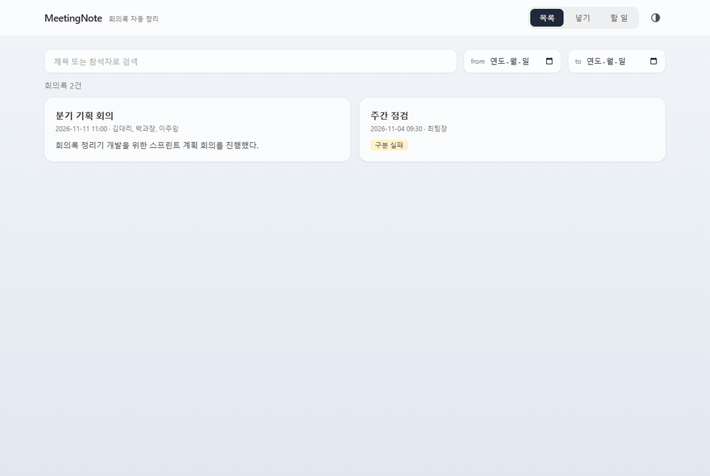</td>
    <td width="50%"><b>검색</b> - <code>q=기획</code> 제목 · 참석자 일치만<br>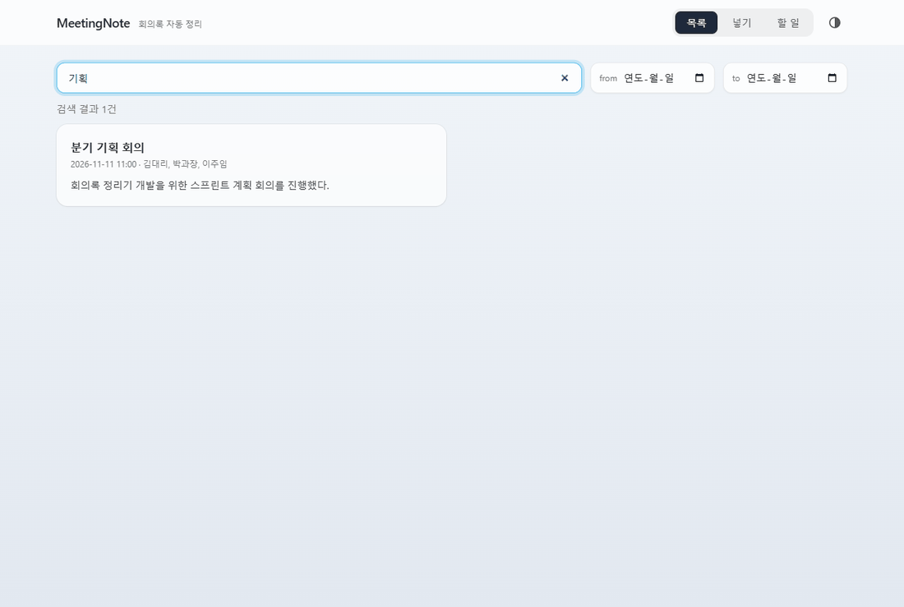</td>
  </tr>
  <tr>
    <td width="50%"><b>상세</b> - 카드를 누르면 뜨는 겹침 창, 제목 수정 · 삭제<br>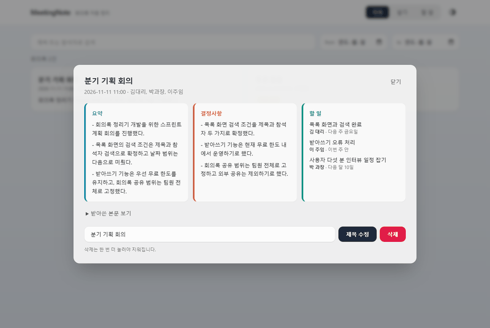</td>
    <td width="50%"><b>할 일</b> - 담당자 · 기한 · 회의, 회의 날짜 오래된 순<br>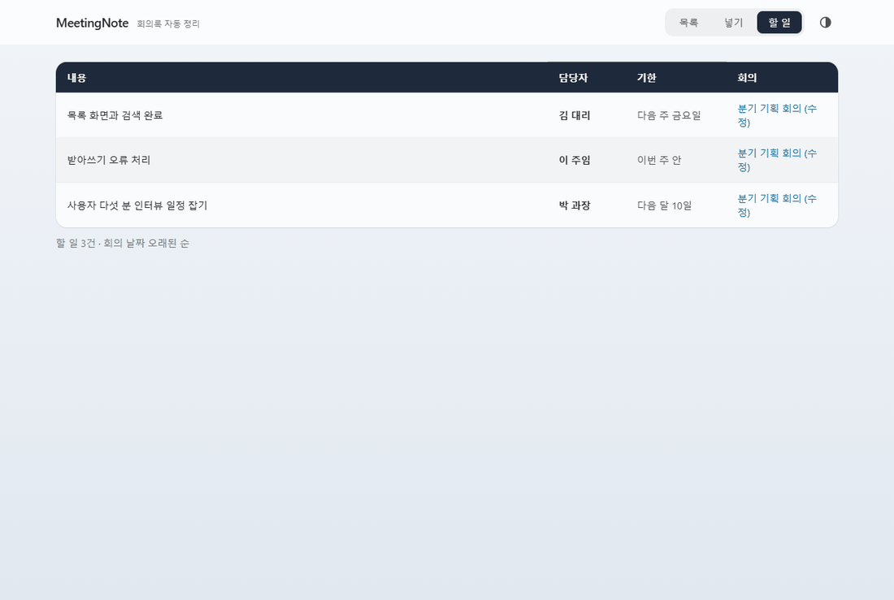</td>
  </tr>
  <tr>
    <td width="50%"><b>구분 실패</b> - 20자 미만 메모는 저장만 하고 실패로 표시<br>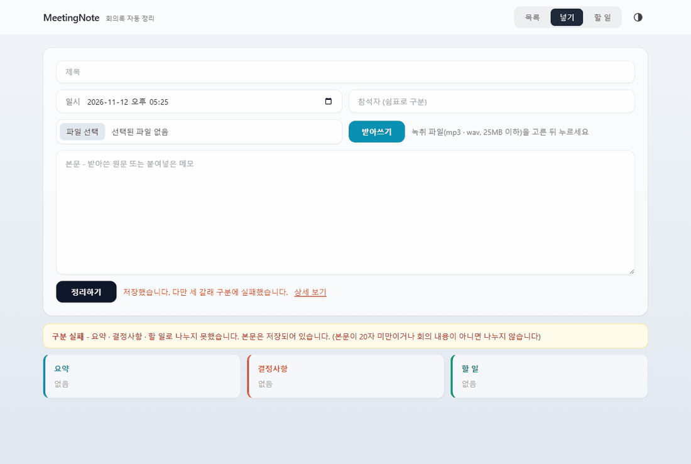</td>
    <td width="50%"><b>모바일 360px</b> - 목록 · 넣기 · 할 일<br>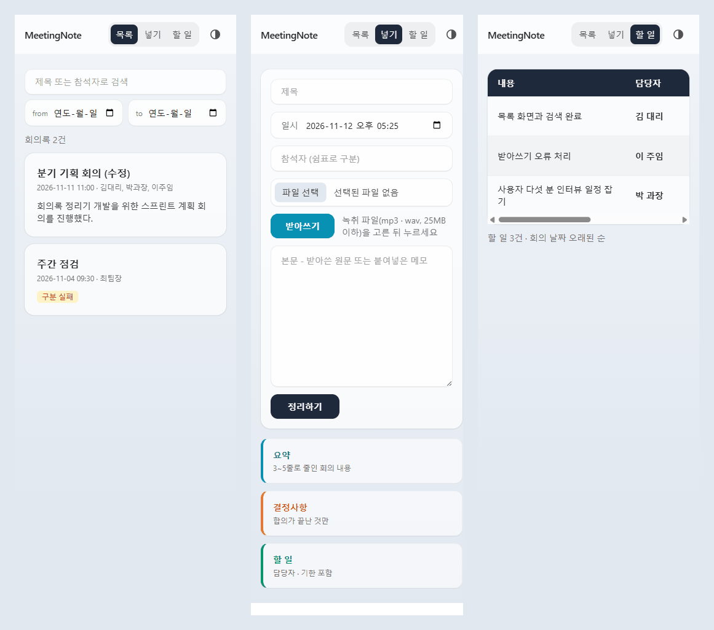</td>
  </tr>
</table>

<details>
<summary><b>Swagger UI (/docs)</b> - 펼쳐 보기</summary>
<br>
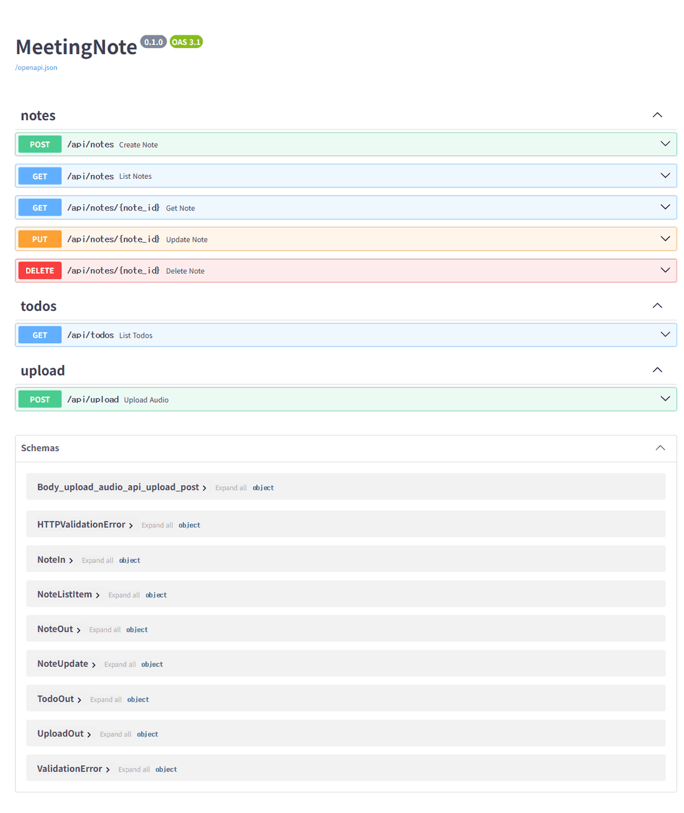
<br><br>
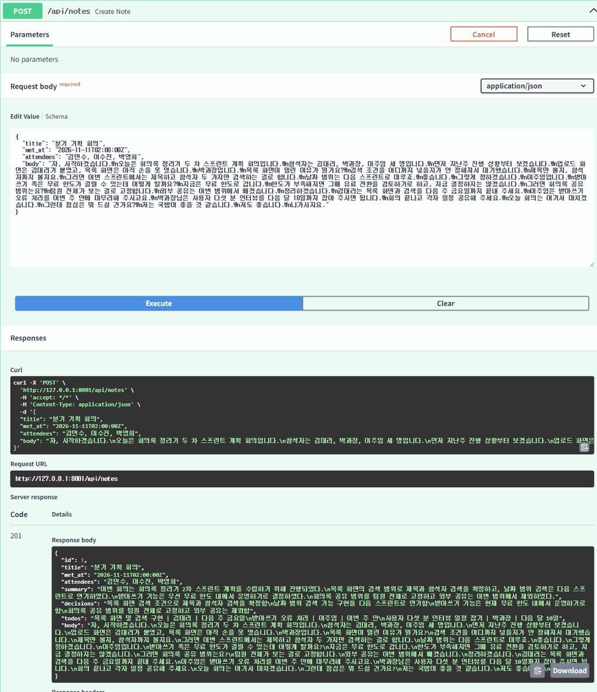
</details>

---

## 🏗️ 동작 구조

### 전체 구성

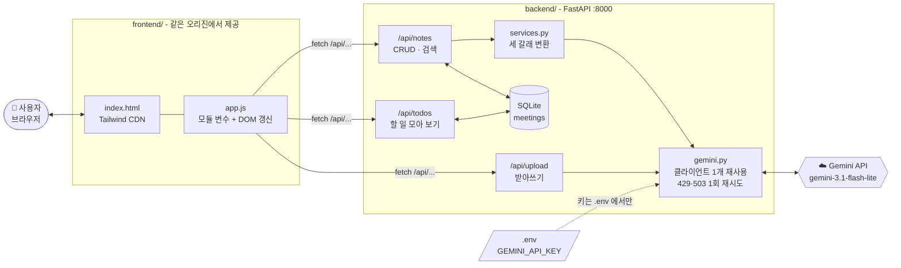

### 녹취 → 받아쓰기 → 세 갈래 저장 (시퀀스)

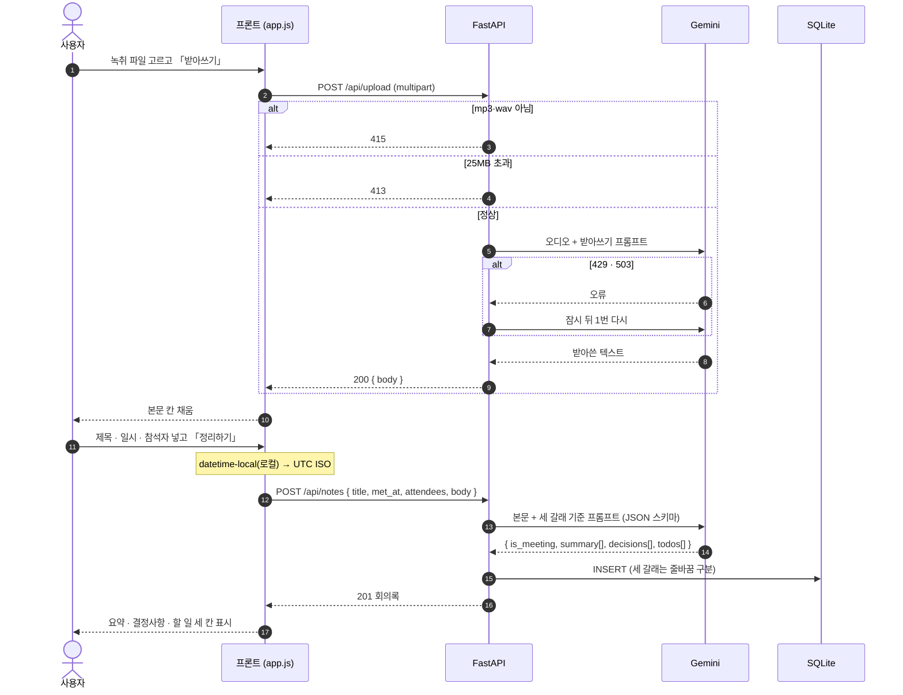

### 세 갈래 구분 판단 흐름

저장은 **언제나 201**. 구분이 안 되면 세 칸을 비워 저장하고, 화면에서 「구분 실패」로 보여 준다.

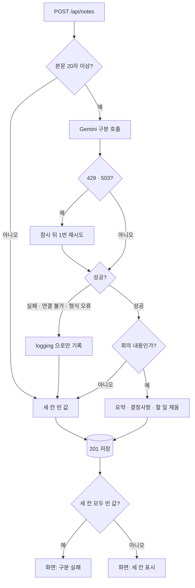

### 시각 처리 (UTC ↔ 로컬)

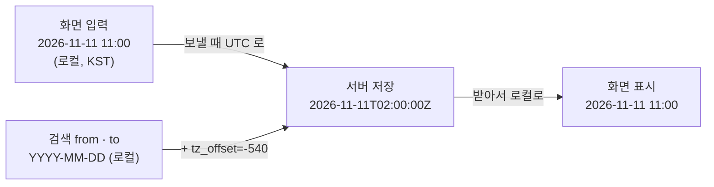

---

## 🗄️ 데이터 모델

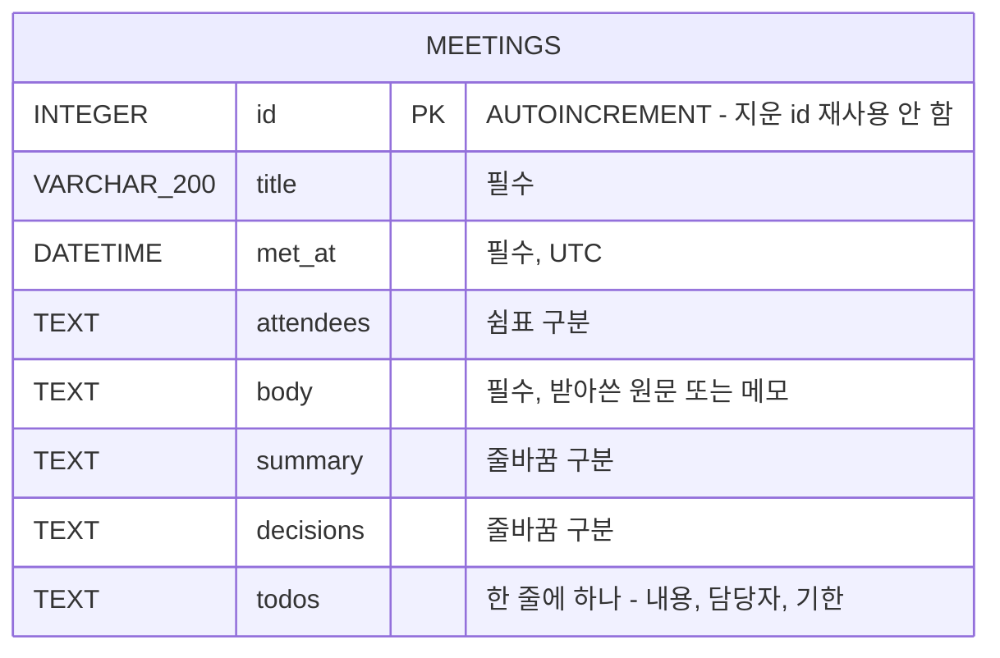

`todos` 저장 예:

```text
목록 화면 및 검색 구현 | 김대리 | 다음 주 금요일
받아쓰기 오류 처리 | 이주임 | 이번 주 안
사용자 다섯 분 인터뷰 일정 잡기 | 박과장 | 다음 달 10일
```

---

## 🔌 REST API

모든 경로는 `/api/` 접두사. 서버를 띄우면 **http://localhost:8000/docs** 에서 Swagger 로 바로 시험할 수 있다.

| 메서드 | 경로 | 성공 | 설명 |
|---|---|---|---|
| `POST` | `/api/notes` | **201** | 저장하며 세 갈래 구분까지 |
| `GET` | `/api/notes` | **200** | 목록 (`body` 제외). `q` · `from` · `to` · `tz_offset` |
| `GET` | `/api/notes/{id}` | **200** | 단건 (`body` 포함) |
| `PUT` | `/api/notes/{id}` | **200** | 수정. 세 갈래는 보내면 바꾸고 빠지면 유지 |
| `DELETE` | `/api/notes/{id}` | **204** | 삭제 |
| `GET` | `/api/todos` | **200** | `what · who · when · note_id · note_title`, 회의 날짜 오래된 순 |
| `POST` | `/api/upload` | **200** | 녹취 파일 → `{ "body": "받아쓴 텍스트" }` |

### 오류 코드

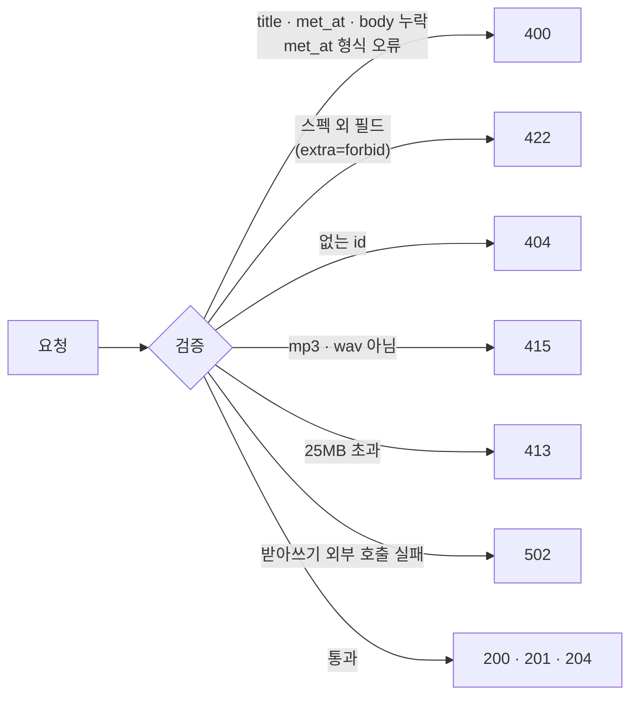

> FastAPI 기본은 검증 실패를 422 로 낸다. 이 프로젝트는 예외 핸들러로 **400** 으로 바꾸고, **스펙 외 필드만 422** 로 남긴다.

---

## 🚀 빠르게 시작하기

### 1. 키 넣기

```bash
cp .env.example .env
# .env 의 GEMINI_API_KEY= 뒤에 키를 넣는다 (.env 는 .gitignore 에 있어 올라가지 않는다)
```

### 2. 설치

```bash
python -m venv .venv
# Windows
.venv\Scripts\pip install -r backend/requirements.txt
# macOS · Linux
.venv/bin/pip install -r backend/requirements.txt
```

### 3. 실행

```bash
cd backend
../.venv/Scripts/python -m uvicorn app.main:app --port 8000
```

| 주소 | 내용 |
|---|---|
| http://localhost:8000 | 앱 (프론트) |
| http://localhost:8000/docs | Swagger UI |

> 서버를 띄운 뒤 **첫 Gemini 호출은 느릴 수 있다** (수십 초 ~ 몇 분). 두 번째 호출부터는 1초 안팎. 화면은 기다리는 동안 경과 초를 보여 준다.

---

## 🧪 테스트

```bash
cd backend
../.venv/Scripts/python -m pytest -v
```

테스트도 **실제 Gemini 를 부른다** (대역 금지). 호출 사이는 1초씩 띄운다.

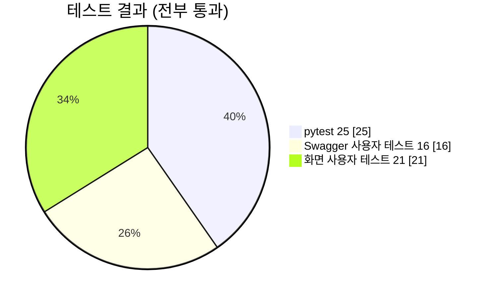

| 종류 | 범위 | 결과 | 보고서 |
|---|---|---|---|
| **pytest** | 매트릭스 15 + 명세 조항 10 | ✅ 25 / 25 | - |
| **Swagger 사용자 테스트** | 엔드포인트 7개, 정상 · 오류 경로 (Playwright) | ✅ 16 / 16 | [백엔드_API_테스트_보고서.docx](백엔드_API_테스트_보고서.docx) |
| **화면 사용자 테스트** | 04-tasks 3.1 ~ 3.8 + 성공 기준 4개 (Playwright) | ✅ 21 / 21 | [프론트엔드_화면_테스트_보고서.docx](프론트엔드_화면_테스트_보고서.docx) |

<details>
<summary><b>테스트 매트릭스 15케이스</b></summary>

| # | 케이스 | 요청 | 기대 |
|---|---|---|---|
| 1 | 정상 생성 | `POST /api/notes` | 201 + 세 갈래 |
| 2 | 목록 | `GET /api/notes` | 200, body 없음 |
| 3 | 단건 | `GET /api/notes/{id}` | 200, body 있음 |
| 4 | 수정 | `PUT` 전 필드 | 200 |
| 5 | 삭제 | `DELETE` | 204 |
| 6 | 검색 | `?q=기획` | 제목 · 참석자 일치만 |
| 7 | 할 일 | `GET /api/todos` | 200 |
| 8 | title 누락 | | 400 |
| 9 | met_at 형식 오류 | | 400 |
| 10 | 없는 id | | 404 |
| 11 | 스펙 외 필드 | | 422 |
| 12 | 업로드 mp4 | | 415 |
| 13 | 업로드 30MB | | 413 |
| 14 | 업로드 중 Gemini 연결 실패 | | 502 |
| 15 | 저장 중 Gemini 연결 실패 | | 201, 세 칸 빈 값 |

</details>

---

## 📁 폴더 구조

```text
meetingnote/
├── backend/
│   ├── app/
│   │   ├── main.py          # 앱 · 400/422 예외 핸들러 · 프론트 정적 제공
│   │   ├── config.py        # .env 읽기, 업로드 한도
│   │   ├── database.py      # SQLite 연결
│   │   ├── models.py        # Meeting (sqlite_autoincrement)
│   │   ├── schemas.py       # 요청 · 응답 (extra=forbid, UTC 직렬화)
│   │   ├── gemini.py        # 받아쓰기 · 세 갈래 구분, 재시도
│   │   ├── services.py      # 세 갈래 저장 형식 변환
│   │   └── routers/         # notes · todos · upload
│   ├── tests/               # test_matrix.py · test_specs.py · fixtures/
│   └── requirements.txt
├── frontend/
│   ├── index.html           # 화면 4종 · Tailwind CDN
│   └── app.js               # 상태 · API · 시각 변환 · 테마
├── docs/                    # 설계 문서 6종 · 화면구성.pdf · screenshots/
├── CLAUDE.md                # 작업 규칙
└── .env.example
```

---

## 📚 설계 문서

`docs/` 아래 6개를 **이 순서대로** 읽는다.

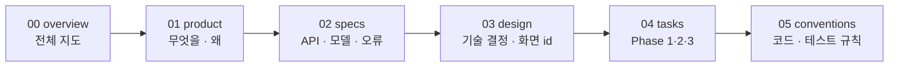

| 문서 | 내용 |
|---|---|
| [00-overview](docs/00-overview.md) | 프로젝트 한 줄, 문서 매핑, 관심사 분리 |
| [01-product](docs/01-product.md) | 목표 · 페르소나 · MVP 범위 · 성공 기준 |
| [02-specs](docs/02-specs.md) | 데이터 모델 · 세 갈래 기준 · API 7개 · 검증 · 실패 처리 |
| [03-design](docs/03-design.md) | 기술 결정 8개 · 화면 요소 id · 의존성 정책 |
| [04-tasks](docs/04-tasks.md) | Phase 1 설계 · 2 백엔드 · 3 프론트 체크리스트 (모두 완료) |
| [05-conventions](docs/05-conventions.md) | 명명 · 금지 6개 · 테스트 매트릭스 · 커밋 규칙 |
| [화면구성.pdf](docs/화면구성.pdf) | 화면 배치와 요소 이름 |

### 진행 상황

```mermaid
gantt
    title MVP 진행 (2026-11-12)
    dateFormat HH:mm
    axisFormat %H:%M
    section Phase 1 설계
    CLAUDE.md + docs 6종      :done, p1, 16:15, 30m
    section Phase 2 백엔드
    API 7개 + 받아쓰기 + pytest :done, p2, after p1, 20m
    section Phase 3 프론트
    화면 4종 + API 연결         :done, p3, after p2, 15m
    section 검증
    Swagger · 화면 사용자 테스트 :done, v1, after p3, 20m
```

---

<div align="center">

**기술 스택 고정** · FastAPI + SQLite · Vanilla JS + Tailwind CDN · Gemini · pytest

</div>
